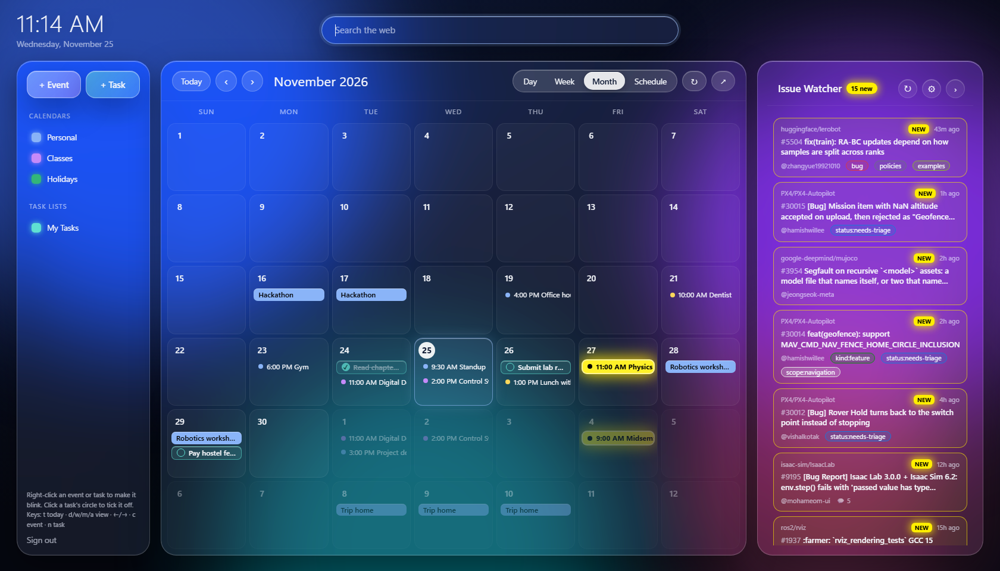

# calendar-newtab

A new tab page that shows my Google Calendar, my Google Tasks, and the latest GitHub issues from repos I follow, all on one screen. I open a hundred tabs a day, so this way I see what's coming up without opening anything.



It's a small browser extension: plain HTML, CSS and JavaScript, no build step and no server. Your browser talks to Google and GitHub directly.

## What it does

**Calendar.** Month, week, day and schedule views. You can create, edit, delete and drag events around just like on calendar.google.com, and turn individual calendars on or off in the sidebar.

**Tasks.** Google Tasks show up on their due date. Click the circle to tick one off, click the title to edit it, or use **+ Task** to add one.

**Blinking reminders.** Right-click any event or task and it starts pulsing bright yellow. I use this for tests and deadlines I really can't miss. Right-click again to stop it.

**Issue feed.** The right panel lists new open issues across a set of GitHub repos, newest first. Anything opened since you last looked gets a NEW tag. Hit the little × on an issue you've already checked and don't care about, and it stays hidden (there's an undo, and the gear menu can bring hidden ones back). It comes with a list of robotics repos (ROS 2, PX4, ArduPilot, MoveIt, MuJoCo...) because that's what I watch. Change it with the gear icon.

There's also a search box that uses your browser's default search engine, a clock, and a few keyboard shortcuts.

## Install

It isn't on the Chrome Web Store, so you load it yourself. That takes about a minute:

1. Download this repo (green **Code** button → **Download ZIP**) and unzip it somewhere you'll keep it. If you move the folder later, the extension ID changes and you'd have to redo step 2 of the setup.
2. Open `brave://extensions` (or `chrome://extensions`, `edge://extensions`).
3. Turn on **Developer mode**, click **Load unpacked**, and pick the unzipped folder.
4. Open a new tab. If the browser asks whether to keep the new tab page, say yes.

To have it show up when the browser starts, set **On startup** to **Open the New Tab page** in your browser's settings.

### On Linux

It's the same extension on Windows, macOS and Linux; nothing to build or install besides the browser. Tested with Brave on Ubuntu, and Chrome/Chromium work the same way.

1. Clone it into a folder you'll keep, so updating is a `git pull`:
   ```bash
   git clone https://github.com/OceanicKr/LiquidCalender.git ~/calendar-newtab
   ```
   (Or use the ZIP like above.) If your browser is the Snap or Flatpak build, keep the folder somewhere plain inside your home folder, not a hidden `~/.something` folder, or the file picker can't see it.
2. Open `brave://extensions` (or `chrome://extensions`), turn on **Developer mode**, click **Load unpacked** and pick that folder.
3. Open a new tab and follow [Connecting Google](#connecting-google) below. If you already set it up on another computer, you don't need a new Google Cloud project: see [Using it on more than one computer](#using-it-on-more-than-one-computer).

To update later:
```bash
cd ~/calendar-newtab && git pull
```
then click the reload icon on the extension in `brave://extensions`.

**Event highlight looks dark olive instead of bright yellow?** You've got Brave/Chrome's experimental **Auto Dark Mode for Web Contents** flag on. It darkens every bright background on every page, and there's no way for a page to opt out. Set `brave://flags/#enable-force-dark` (or `chrome://flags/#enable-force-dark`) back to **Default** and relaunch. If you want dark websites, the Dark Reader extension does it without touching this page.

### Using it on more than one computer

Every install gets its own extension ID, and with it its own redirect URL (the `https://….chromiumapp.org/` address on the Connect screen). It changes between computers, and also if you move the folder.

You can keep using the same Google Cloud project and client ID everywhere: open your client in Google Cloud (**Google Auth Platform → Clients**), click **Add URI** under **Authorized redirect URIs**, paste the new computer's redirect URL next to the old one, and save. Then paste the same client ID on the new computer and connect.

Settings live in each browser, so hidden issues, your repo list and task highlights don't carry over between computers. Event highlights do, since they're saved on the Google event.

## Connecting Google

Google doesn't let a random extension read your calendar, so you create your own free "OAuth client" in Google Cloud and paste its ID into the extension. No card is needed, and it takes about five minutes the first time.

The new tab page walks you through it and shows the exact redirect URL to copy. If you want screenshots-level detail, read [docs/SETUP.md](docs/SETUP.md).

The issue feed doesn't need any of this. It works as soon as the extension is loaded.

## Keyboard shortcuts

| Key | Does |
|---|---|
| `t` | jump to today |
| `d` `w` `m` `a` | day / week / month / schedule view |
| `←` `→` | previous / next |
| `c` | new event |
| `n` | new task |

## Good to know

- Sign-in tokens last about an hour and renew quietly in the background, also after a restart, as long as you're still signed in to Google in the browser. It remembers which account you connected, so being signed in to several Google accounts is fine. If Google ever wants you to approve again, the Connect button comes back with the reason underneath it.
- While your Google Cloud app is in "Testing" mode, Google sometimes asks you to approve it again after a week or so. That's normal.
- Event blinking is saved on the Google event itself, so it carries over to other computers. Task blinking is saved in your browser only, because Google Tasks has nowhere to store it.
- Tasks without a due date aren't shown, since there's no day to put them on.
- The issue feed uses GitHub's public search API with no login. It refreshes every two minutes, well under GitHub's limit.
- If you'd rather get a phone notification for new issues, I made [issue-watcher](https://github.com/OceanicKr/issue-watcher) for that. It sends issues to Telegram.

## Privacy

Nothing leaves your browser except calls to Google's Calendar and Tasks APIs (with your own client ID) and GitHub's public API. There's no analytics or tracking, and no server of mine involved. Your settings live in the browser's extension storage.

## Files

```
manifest.json   extension config
newtab.html     the page
newtab.css      the glass look
app.js          calendar, tasks, editor, drag and drop
auth.js         Google sign-in
api.js          Calendar + Tasks API calls
issues.js       GitHub issue panel
```

## License

MIT. Do whatever you like with it.
